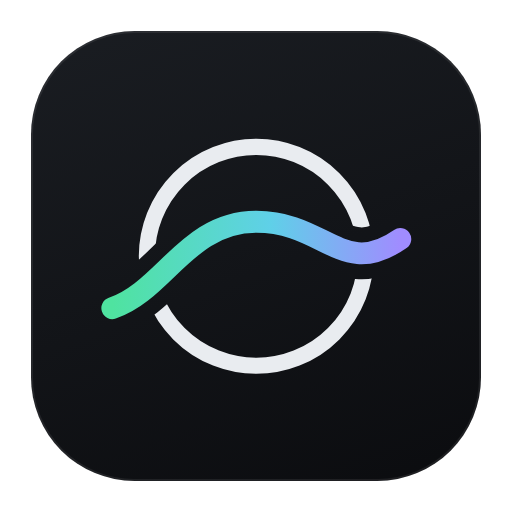

<div align="center">

#  Aurora

A minimal, privacy-first VRChat companion: your friends and history, clear insights, a mic mixer with noise suppression and chatbox tools.

</div>

Aurora is a personal fork of [VRCX](https://github.com/vrcx-team/VRCX) (MIT licensed) by xoliexen. It keeps VRCX's features (friends, worlds, the feed, the game log, favorites, moderation) under a new, minimal interface. It is not made by or affiliated with VRChat Inc. or the VRCX team.

## What is different

- **A calm, minimal look:** Aurora Dark and Aurora Light, flat surfaces, one accent colour (or grayscale), its own icon set and logo. Neon, the old pink look, is still in the theme list.
- **A sidebar that makes sense:** grouped into People, Worlds, Insights and Aurora, with the Aurora tools one click away.
- **Mic:** mixes one app's music with your voice into a virtual cable, with noise suppression (fans, keyboard, room noise), bass boost, up to 500% voice and 1000% music, and it turns on by itself when VRChat opens.
- **Insights:** time played per day, your week as a heat map, who you spend time with, when friends come online, friends over time, where you hang out and how many people you meet.
- **Chatbox:** live text in the VRChat chatbox with pages and integrations (time, music, system stats...).
- **Automations:** alarms and timers, and a status that switches itself while chosen friends are online.
- **Data safety:** daily database backups, and Aurora never deletes your time together or online history.
- **Data cleanup and app lock:** remove clutter (invites, expired notifications, caches), and an optional PIN.
- **No calls home:** the crash reporter is off; the updater only reads this repository's releases.
- **Safe by design:** no auto-kick, bulk moderation or other automation that can get an account banned.

## Get the app

1. Go to the [Releases page](https://github.com/kx2158/aurora/releases/latest) and download **`Aurora_Setup_x64.exe`**. That one file is all you need.
2. Run it. If you have VRCX installed, Aurora replaces it, copies your data to `Documents\Aurora-backups` as a safety backup (the data itself stays where it is, so your history, favorites and settings carry over), and puts **Aurora** shortcuts on your desktop and Start menu.
3. Open **Aurora**. It starts in Aurora Dark.

After that Aurora updates itself: it checks this repository's releases and offers new versions in the app (`Settings > System`).

### About the Windows warning

Windows SmartScreen or Defender may say "unknown publisher" or flag the installer. That is because the installer is not code-signed yet (signing certificates cost money or need an application) and new files have no download reputation. The whole source is in this repository, and every installer is built from it by GitHub Actions in the open (`.github/workflows/aurora-windows.yml`), so you can read exactly what goes into it or build it yourself. Do not turn off Defender or add folder exclusions for Aurora. To report a false positive, Microsoft takes submissions at https://www.microsoft.com/wdsi/filesubmission.

### Notes

- Aurora installs over VRCX and uses the same data folder (`%APPDATA%\VRCX`). Do not run stock VRCX and Aurora at the same time. Back up that folder before the first run if you want to be extra safe.
- This is a hobby project and has had little testing on real machines. If something breaks, open an issue.

## Build it yourself

Needs Node 24 or newer and the .NET 10 SDK.

```
npm install
npm run dev        # UI preview in the browser
npm run prod       # production UI build
```

The Windows app is built from `Dotnet/VRCX-Cef.csproj`, and the installer from `Installer/installer.nsi`. See `.github/workflows/aurora-windows.yml` for the exact steps.

## Customizing

`MY_VERSION.md` explains what was changed, where things live (themes, settings, database, log parsing), how to rename the app, and how to pull in upstream VRCX fixes later.

## Credits and license

Aurora is built on VRCX by the VRCX team and contributors, released under the MIT license. The license and copyright notice are kept in `LICENSE`. VRChat is a trademark of VRChat Inc.

## Fork it

See [docs/GUIDE.md](docs/GUIDE.md) for how the code is laid out, how to add settings, pages and features, and how to restyle the app.
