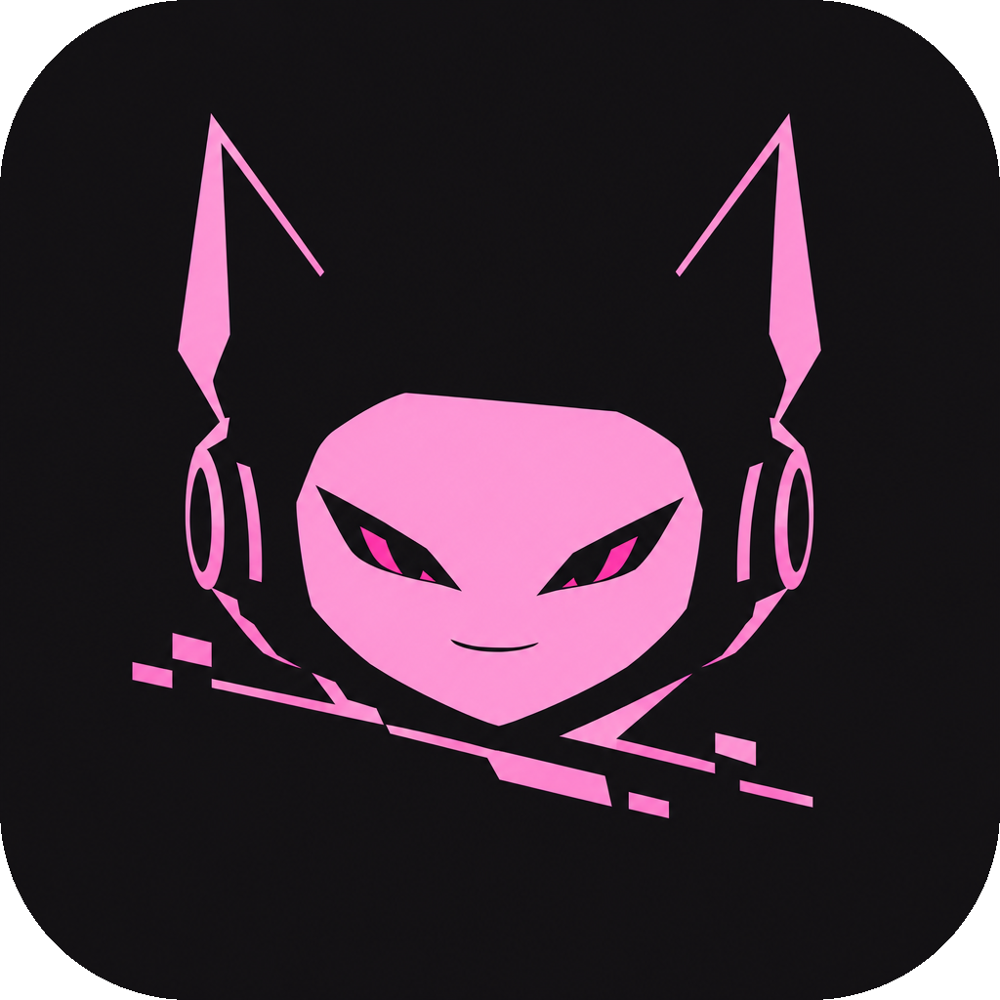

<div align="center">

#  Aurora

A personal, privacy-first VRChat companion with a baby pink look, a robot mascot voice and built-in data cleanup.

</div>

Aurora is a personal fork of [VRCX](https://github.com/vrcx-team/VRCX) (MIT licensed). It is the full VRCX app, so friends, worlds, avatars, the feed, the game log and the rest all work the way you know, plus the changes below. It is not made by or affiliated with VRChat Inc. or the VRCX team.

## What is different

- **Aurora look, dark and light:** a dark pink theme (default) and a baby pink light theme, both under `Settings > Interface > Theme`. Choose *System* and Aurora follows Windows: dark at night, light by day.
- **Meet Aurora:** the app's mascot is named Aurora too, a black-helmeted robot with a baby pink face-screen. Her icon is `images/aurora/icon.png`.
- **Mascot voice:** short spoken lines from a local text-to-speech model (Kokoro-82M, runs on the CPU, nothing leaves your PC), with robot effects: bitcrusher, sample crush, ring modulation and stutter.
- **Data cleanup:** removes invite data, expired notifications, download logs, caches and old feed entries. Preview first, confirm, optional automatic run after login.
- **App lock:** optional PIN with idle auto-lock and growing delays after wrong tries. It keeps people out of the app. It does not encrypt files on disk, so use BitLocker for that.
- **No calls home:** the updater and the crash reporter are switched off.
- **Hardening:** sandboxed windows in the Electron build, no extra windows, no navigating away, no camera, microphone or location requests.
- **Safe by design:** Aurora reads your VRChat logs and uses VRChat's normal API the way VRCX does. It has no auto-kick, bulk moderation or other automation, because that can get an account banned.

All Aurora settings live in `Settings > Aurora`.

## Get the app

1. Go to the [Releases page](https://github.com/kx2158/aurora/releases/latest) and download **`Aurora_Setup_x64.exe`**. That one file is all you need.
2. Run it. If you have VRCX installed, Aurora replaces it, copies your data to `Documents\Aurora-backups` as a safety backup (the data itself stays where it is, so your history, favorites and settings carry over), and puts **Aurora** shortcuts on your desktop and Start menu.
3. Open **Aurora**. It starts in the pink Aurora theme.

After that Aurora updates itself: it checks this repository's releases and offers new versions in the app (`Settings > System`).

### About the Windows warning

Windows SmartScreen or Defender may say "unknown publisher" or flag the installer. That is because the installer is not code-signed yet (signing certificates cost money or need an application) and new files have no download reputation. The whole source is in this repository, and every installer is built from it by GitHub Actions in the open (`.github/workflows/aurora-windows.yml`), so you can read exactly what goes into it or build it yourself. Do not turn off Defender or add folder exclusions for Aurora. To report a false positive, Microsoft takes submissions at https://www.microsoft.com/wdsi/filesubmission.

### Notes

- Aurora installs over VRCX and uses the same data folder (`%APPDATA%\VRCX`). Do not run stock VRCX and Aurora at the same time. Back up that folder before the first run if you want to be extra safe.
- This is a hobby project and has had little testing on real machines. If something breaks, open an issue.

## Build it yourself

Needs Node 24 or newer and the .NET 10 SDK.

```
npm install
npm run dev        # UI preview in the browser
npm run prod       # production UI build
```

The Windows app is built from `Dotnet/VRCX-Cef.csproj`, and the installer from `Installer/installer.nsi`. See `.github/workflows/aurora-windows.yml` for the exact steps.

## Customizing

`MY_VERSION.md` explains what was changed, where things live (themes, settings, database, log parsing), how to rename the app, and how to pull in upstream VRCX fixes later.

## Credits and license

Aurora is built on VRCX by the VRCX team and contributors, released under the MIT license. The license and copyright notice are kept in `LICENSE`. VRChat is a trademark of VRChat Inc.
